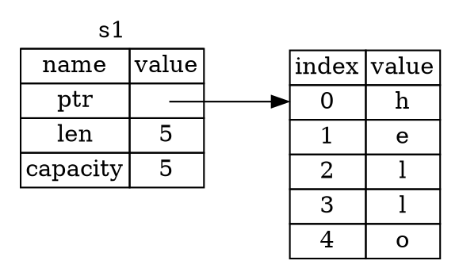
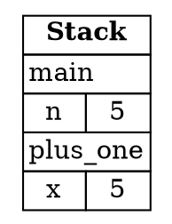
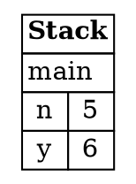
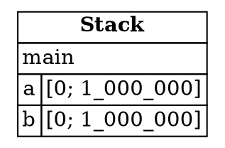
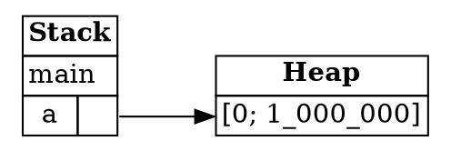
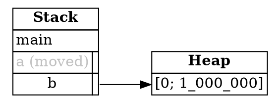
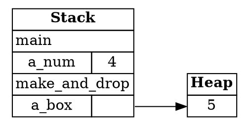
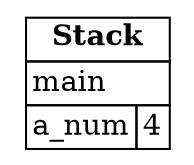
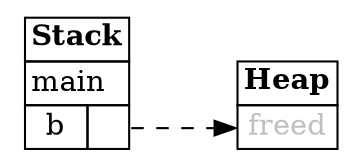

## The Stack and the Heap

Ownership is the idea that makes Rust different from most languages you may know. Many experienced
programmers find it the hardest part of Rust, so this chapter takes it slowly. The goal is not
to memorize rules, but to understand why they exist.

Everything starts with memory. A program needs somewhere to keep its values while it runs, and Rust
puts them in one of two places: the **stack** and the **heap**.

---

### The stack

Each time a function is called, Rust makes a **stack frame** for it. A frame is a small area of
memory that holds the variables declared inside that function. When the function returns, its frame is
removed, and the variables in it are gone.

Frames are stacked on top of one another, like plates. The most recent function call sits on top, and it's
always the first one to be removed. That's why it's called a stack.

Values that are fixed in size and simple to copy, such as integers, booleans, and characters, usually live on
the stack. Copying them is cheap, so Rust does it freely.

---

### The heap

Some data isn't that simple. A piece of text whose length can change, for example, doesn't have a size known
in advance. For that, Rust uses the **heap**: a separate region of memory where data can live for as long as
it's needed, not just for the length of one function.

To use the heap, you ask for memory explicitly. The most basic way is `Box::new`, which puts a value on the
heap and gives you back a **pointer**. A pointer is a value that says where something lives in memory.

The stack frame doesn't hold the boxed value itself. It holds the pointer, which is small and cheap to copy.
The value the pointer points to is the **pointee**.

Here is the layout of a `String`, which keeps its characters on the heap. The variable `s1` on the stack holds a
pointer, a length, and a capacity. The pointer leads to the characters in the heap:



*Diagram adapted from the [Brown University edition of The Rust Programming Language](https://rust-book.cs.brown.edu/).*

The diagram above is read left to right. On the left, the stack holds `s1`, with its pointer, length, and
capacity. The arrow leaves the pointer and reaches the five characters on the right, which are the heap data.

---

### Frames on the stack

Let's trace a small program that calls a function, and look at what the stack holds at three points. The
markers `L1`, `L2`, and `L3` show where we stop.

```rust
fn main() {
    let n = 5;        // L1
    let y = plus_one(n);  // L3
    println!("The value of y is: {y}");
}

fn plus_one(x: i32) -> i32 {
    x + 1             // L2
}
```

Expected output:

```
The value of y is: 6
```

Variables live in **frames**. A frame maps the variables of one function call to their values. Frames are
stacked on top of one another, so the newest call sits on top, and it's the first one removed when its function
returns.

This is the key distinction for the rest of the chapter: **variables live on the stack, and boxes live on the heap.**
A variable holding a box is itself on the stack, but it only holds a pointer. The contents of the box are on the heap.

At **L1**, only `main` has a frame, and it holds `n = 5`:

```dot
digraph {
    node [shape=plaintext];
    stack [label=<<TABLE BORDER="0" CELLBORDER="1" CELLSPACING="0">
        <TR><TD COLSPAN="2"><B>Stack</B></TD></TR>
        <TR><TD COLSPAN="2" ALIGN="LEFT">main</TD></TR>
        <TR><TD>n</TD><TD>5</TD></TR>
    </TABLE>>];
}
```



At **L2**, `plus_one` has been called, so its frame sits on top of `main`'s. The frame for `plus_one` holds `x = 5`,
the argument:



At **L3**, `plus_one` has returned, so its frame has been removed. Only `main` remains, now holding `n = 5` and
`y = 6`:



This is the stack discipline in action. The most recent frame is the first one removed, which is where the
name *stack* comes from.

*Diagrams adapted from the [Brown University edition of The Rust Programming Language](https://rust-book.cs.brown.edu/).*

---

### Boxes on the heap

Copying data on the stack is fine for small values, but a large value can take up a lot of memory. Here's a
program that copies an array of one million numbers:

```rust
fn main() {
    let a = [0; 1_000_000];
    let b = a;
}
```

This fragment prints nothing. It's shown to explain what the stack holds.

After `let b = a`, the `main` frame holds two complete copies of the array, two million numbers in all:



To transfer access to data without copying it, Rust uses a **box**. `Box::new` puts the value on the heap and gives
back a pointer to it. Now there is only ever one array:

```rust
fn main() {
    let a = Box::new([0; 1_000_000]);
    let b = a;
}
```

This fragment also prints nothing. The diagrams below show the state after each line.

At the point of `let b = a`, `a` holds a pointer to the array on the heap:



After `let b = a`, the pointer has moved into `b`. The data on the heap is untouched, and `a` is no longer
allowed to be used:



Now the rule for freeing boxes can be stated. When the frame that owns a box is removed, Rust frees the box's
heap memory. Here is a program that makes a box inside a function:

```rust
fn main() {
    let a_num = 4;
    make_and_drop();
}

fn make_and_drop() {
    let a_box = Box::new(5);
}
```

This program prints nothing. Its only purpose is to show when the box is freed.

While `make_and_drop` runs, its frame holds `a_box`, which points to `5` on the heap:



When `make_and_drop` returns, its frame is removed, and the box it owned is freed with it. Only `main`'s frame
and an empty heap remain:



Rust does not let a program free memory by hand. Imagine a `free` function that releases a box early, and then
the program tries to read through the pointer:

```rust
fn main() {
    let b = Box::new([0; 100]);
    free(b);
    assert!(b[0] == 0);
}
```

This is an illustration only, and it won't compile. Rust has no `free` function, and the program is written to show
what would happen if a box could be freed by hand.

After `free(b)`, the pointer in `b` leads to memory that has been released. The pointer itself is not the
problem, but reading through it is undefined behavior:



*Diagrams adapted from the [Brown University edition of The Rust Programming Language](https://rust-book.cs.brown.edu/).*

---

### Why this matters

Copying a pointer is cheap, but copying the data it points to can be expensive. So when a value moves
from one variable to another, Rust copies the pointer and not the heap data. That's efficient, but it raises a
question: if two variables held the same pointer, which one would free the heap memory when it was done?
Ownership is the rule that answers that question. You'll meet it in the next step.

---

### Try it in the runner

The sample for this step is a small program. It moves a box from `a` to `b`, then prints `b`. Press **F5** to run it. The Output pane should show:

```
b holds 15
```

The comments in `src/main.rs` suggest what to try next. Uncomment a line, or change one, and run again.
The first suggestion is the most important. Rust will refuse to compile a program that uses `a` after
its value has moved to `b`, and the error message explains why. Reading that message is a good way
to learn the ownership rules.

---

### Quiz

*These questions are adapted from the quizzes in the [Brown University edition of The Rust Programming Language](https://rust-book.cs.brown.edu/).*

````quiz
Which of the following best describes the difference between the stack and the heap?

○ The stack can hold pointers to data stored on the heap, while the heap only holds data without pointers
→ Not quite. The heap is allowed to contain pointers too.
○ The stack holds immutable data, while the heap holds mutable data.
→ Not quite. Both the stack and the heap can hold data that is mutable or immutable.
○ The stack holds copyable data, while the heap holds uncopyable data.
→ Not quite. Both can hold data that can be copied, and data that can't.
◉ The stack holds data associated with a specific function, while the heap holds data that can outlive a function
→ Yes. Stack frames belong to a function and are removed when it returns. Heap data can live longer than that.
````

````quiz
Consider this program:

```rust
fn main() {
    let a = Box::new(15);
    let b = a;
    let c = Box::new(15);
}
```

In the final state, how many copies of the number `15` live anywhere in memory? Write your answer as a digit, such as 0 or 1.

[ 2 ]
→ The two boxes contain the two copies of the number 15. The assignment `let b = a` copies the heap pointer, but not the number on the heap.
````

---

*For more detail, see section 4.1 "What Is Ownership?" in [The Rust Programming Language](https://doc.rust-lang.org/book/ch04-01-what-is-ownership.html).*
