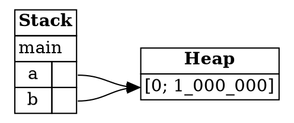

## Deallocation

Heap memory has to be given back when the program no longer needs it. Stack frames are removed automatically
when a function returns. Heap data needs a rule of its own, and this step explains that rule. It's the
rule that ownership is built on.

---

### Why not free memory by hand?

Imagine that Rust let the programmer free heap memory whenever they wanted, with a `free` function. Manual
management like that causes bugs easily. For example, a program could read through a pointer to memory that
has already been freed. The previous step showed that reading freed memory is undefined behavior.

Rust doesn't allow manual freeing, so it needs another answer to the question *when is heap memory freed?*

---

### A first attempt at a rule

Here is a program that allocates and frees a box:

```rust
fn main() {
    let a_num = 4;
    make_and_drop();
}

fn make_and_drop() {
    let a_box = Box::new(5);
}
```

This program prints nothing. It exists to show when the box is freed.

Before `make_and_drop` runs, the only frame is `main`'s. While it runs, `a_box` points to `5` on the heap. When
it returns, its frame is removed, and the heap is empty again. Rust freed the box without any instruction from
the programmer.

Describing this as a rule gives the first version:

> **Box deallocation principle (almost correct):** If a variable is bound to a box, when Rust deallocates the
> variable's frame, then Rust deallocates the box's heap memory.

The rule works for this program. The trouble is that it doesn't say what happens when more than one variable is
bound to the same box.

---

### Where the first rule breaks

Suppose we bind a box to two variables:

```rust
fn main() {
    let a = Box::new([0; 1_000_000]);
    let b = a;
}
```

This fragment prints nothing. It shows what happens to the ownership of the box.

Both `a` and `b` are now bound to the same box. The first rule would free the heap memory once on behalf of `a`,
and again on behalf of `b`. Freeing the same memory twice is undefined behavior, so the rule isn't safe as stated.

Both variables point to the same heap memory, and the rule doesn't say which of them is responsible for
freeing it:



*Diagram adapted from the [Brown University edition of The Rust Programming Language](https://rust-book.cs.brown.edu/).*

---

### Ownership resolves it

The fix is to say exactly one variable is responsible for the box. When `a` is bound to `Box::new(...)`, we say
that `a` **owns** the box. The statement `let b = a` **moves** ownership from `a` to `b`. `a` gives up its
responsibility, so only `b` is left to free the box.

With that concept, the rule can be stated in its correct form:

> **Box deallocation principle (fully correct):** If a variable owns a box, when Rust deallocates the variable's
> frame, then Rust deallocates the box's heap memory.

In the example, `b` owns the array. When `main` ends, Rust frees the box once, on behalf of `b`. `a` doesn't
free it, because `a` no longer owns anything.

This is the central idea of the chapter. Every piece of heap data has exactly one owner, and the owner is
responsible for freeing it. Nothing else may free it, and nothing else may use it once it has been freed.

---

### Try it in the runner

The sample for this step creates a box in one function and frees it when that function returns. Press **F5**.
The Output pane should show:

```
a_box holds 5 while make_and_drop runs
a_num is still 4 after the function returns
```

The comments in `src/main.rs` suggest two things to try: returning the box instead of letting it go out of scope,
and changing the value inside the box. Both show how ownership follows the value, and when the memory is freed.

---

*For more detail, see the section "A Box's Owner Manages Deallocation" in [The Rust Programming Language](https://doc.rust-lang.org/book/ch04-01-what-is-ownership.html).*
