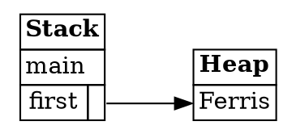
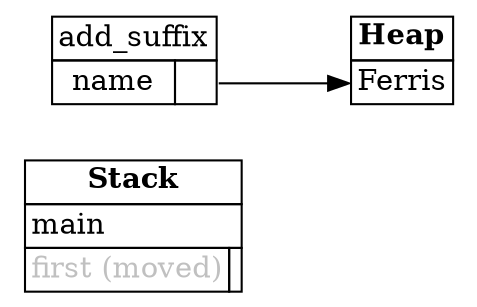
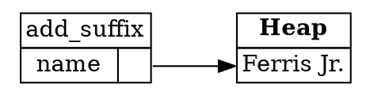
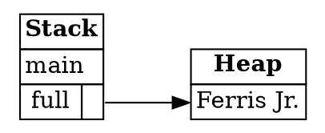

## Ownership and Moves

The last step showed that a box lives on the heap, and that a pointer to it can be copied cheaply. That
raises the question the chapter is built around: if two variables hold a pointer to the same heap data, which
one is responsible for freeing it? Rust's answer is **ownership**, and it's the idea you'll need most in
everything that follows.

---

### The ownership rule

Every piece of heap data has exactly one owner, which is a variable. When the owner goes out of scope,
Rust frees the heap data. Nothing else needs to free it, and nothing else is allowed to.

Here's the rule in more detail, as the Rust Book states it:

> **Box deallocation principle (fully correct):** If a variable owns a box, when Rust deallocates the
> variable's frame, then Rust deallocates the box's heap memory.

Because Rust frees the data exactly once, at a predictable point, you never have to write `free` yourself.
The rule also prevents a bug that would otherwise be easy to make: freeing the same memory twice.

---

### Moves

Consider what happens when a value is assigned to another variable:

```rust
let a = Box::new([0; 1_000_000]);
let b = a;
```

This fragment prints nothing. The pointer is copied from `a` into `b`, but the million numbers on the heap are not copied. Two variables
now hold the same pointer. If both were allowed to free the data, it would be freed twice. So Rust makes
the assignment a **move** instead: ownership of the data transfers from `a` to `b`, and `a` is no longer
allowed to be used.

A move happens on every assignment of heap data, and whenever a value is passed into a function. Passing
`first` into `add_suffix` moves the string into the function, and the function then owns it.

---

### Using a value after it's moved

The sample for this step makes the rule concrete. The function `add_suffix` takes a `String`, adds to it,
and gives it back. Imagine that `main` tried to use `first` after the move:

```rust
println!("{full}, originally {first}");
```

This line is a fragment. It can't be run on its own, because the program it belongs to uses `first` after the move. The
error is shown below.

If Rust allowed this, `first` would point to memory that was freed when `add_suffix` took ownership. Reading it
would be undefined behavior, which is the kind of memory bug that Rust exists to prevent. So Rust refuses to
compile the program, with an error like this:

```text
error[E0382]: borrow of moved value: `first`
  |
2 |     let first = String::from("Ferris");
  |         ----- move occurs because `first` has type `String`, which does not implement the `Copy` trait
3 |     let full = add_suffix(first);
  |                           ----- value moved here
4 |     println!("{full}, originally {first}");
  |                                  ^^^^^ value borrowed here after move
```

The line numbers in the message may differ from the sample. The important parts are the three labels: where
`first` was created, where it was moved, and where it was used afterwards. Rust names the exact place where the
move happened, which is the first thing to check when you see this error.

The error mentions the `Copy` trait. Types such as `i32` implement `Copy`, so assigning one to another
variable copies it, and both variables stay usable. `String` does not implement `Copy`, because it owns heap
data, and copying that data by accident would be expensive. Moves are the default for heap data for that reason.

The compiler enforces the rule that matters most:

> **Moved heap data principle:** if a variable `x` moves ownership of heap data to another variable `y`, then
> `x` cannot be used after the move.

---

### Cloning avoids moves

Sometimes you want to keep using a value after giving it to a function. The `.clone()` method makes a
complete copy of the data, with a new pointer to a new heap allocation:

```rust
let first_clone = first.clone();
let full = add_suffix(first_clone);
```

This fragment is part of the `add_suffix` program, which prints `Ferris Jr.`. The original `first` still points to its own data, so it's safe to keep using it. Cloning costs time and
memory, because the data is copied, so use it when you need two independent values, and not just to satisfy
the compiler. Often, a better design is to pass a reference, which you'll meet in the next sub-chapter.

---

### Collections use boxes

Collections such as `Vec`, `String`, and `HashMap` hold a variable number of values, so they keep their contents on
the heap. Their internal workings are based on the same pointers and boxes you've met. Here's the `add_suffix`
program again, in more detail:

```rust
fn main() {
    let first = String::from("Ferris");
    let full = add_suffix(first);
    println!("{full}");
}

fn add_suffix(mut name: String) -> String {
    name.push_str(" Jr.");
    name
}
```

Expected output:

```
Ferris Jr.
```

At the start, `first` owns a string whose characters are on the heap:



Calling `add_suffix(first)` moves ownership into `name`. The string data stays where it is, and only the pointer is
copied. `first` is no longer usable:



`push_str` needs more room than the string has, so it can't simply write into the existing allocation. It creates
a larger allocation, writes `Ferris Jr.` into it, and frees the original. `name` now owns the new allocation, and
`first` still points to memory that has been freed:



When `add_suffix` returns, ownership moves to `full`, and the function's frame is removed. Only `main` remains, and
`full` owns the string:



This is the pattern for every collection. The collection owns its heap data, and moving the collection moves that
ownership. The growing string also shows that some operations free memory internally, and that is safe because the
string's owner is the only one allowed to use its data.

*Diagrams adapted from the [Brown University edition of The Rust Programming Language](https://rust-book.cs.brown.edu/).*

---

### Try it in the runner

The sample for this step creates a string, moves it into `add_suffix`, and prints the result. Press **F5**. The
Output pane should show:

```
Ferris Jr.
```

The comments in `src/main.rs` suggest two things to try. The first is to uncomment the line that uses `first`
after the move. Rust will refuse to compile it, and the error is the one described above. The second is to
clone `first` and pass the copy into `add_suffix`, so that the original can still be printed.

---

### Quiz

*These questions are adapted from the quizzes in the [Brown University edition of The Rust Programming Language](https://rust-book.cs.brown.edu/).*

````quiz
Which of the following is NOT a kind of undefined behavior?

○ Using a pointer that points to freed memory
→ This is undefined behavior. Reading or writing freed memory is exactly the kind of bug Rust prevents.
○ Freeing the same memory a second time
→ This is undefined behavior. Rust would free the memory twice, once on behalf of each owner.
○ Using a non-boolean value as an `if` condition
→ This is undefined behavior. Rust doesn't define what an `if` does with a value that isn't `true` or `false`.
◉ Having a pointer to freed memory in a stack frame
→ Yes, this is the one that isn't undefined behavior. It's safe to hold a pointer to freed memory, as long as you don't use it.
````

````quiz
Does this program compile?

```rust
fn add_suffix(mut s: String) -> String {
  s.push_str(" world");
  s
}

fn main() {
  let s = String::from("hello");
  let s2 = add_suffix(s);
  println!("{}", s2);
}
```

○ This program does not compile
→ Not quite. `s` is not used after it's moved into `add_suffix`, so the program is valid.
◉ This program does compile
→ Yes. The move is safe, because the original `s` is never used again.
---
If it compiles, what does it print?

[ hello world ]
→ Yes. `add_suffix` adds " world" to the string, so the program prints `hello world`.
````

````quiz
Does this program compile?

```rust
fn main() {
  let s = String::from("hello");
  let s2;
  let b = false;
  if b {
    s2 = s;
  }
  println!("{}", s);
}
```

○ This program does compile
→ Not quite. Rust doesn't check whether an `if` branch will run. It assumes `s` might be moved, so using it afterwards is an error.
◉ This program does not compile
→ Yes. `s` could be moved inside the `if`, so Rust refuses to let the program use `s` on the last line, even though `b` is always `false`.
````

````quiz
Say we have a function that moves a box:

```rust
fn move_a_box(b: Box<i32>) {
  // This space intentionally left blank
}
```

Below are four snippets that Rust rejects. Imagine that Rust allowed them to compile and run. For each one,
would it cause undefined behavior?

```rust
let b = Box::new(0);
let b2 = b;
move_a_box(b);
```

○ No, this doesn't cause undefined behavior
◉ Yes, this causes undefined behavior
→ Yes. `b` is moved into `b2`, then moved again into `move_a_box`. Ownership of the box would be freed twice.
---
Would this cause undefined behavior?

```rust
let b = Box::new(0);
move_a_box(b);
println!("{}", b);
```

○ No, this doesn't cause undefined behavior
◉ Yes, this causes undefined behavior
→ Yes. `move_a_box` frees the box, and then `println!` reads `b` after it's been freed.
---
Would this cause undefined behavior?

```rust
let b = Box::new(0);
move_a_box(b);
let b2 = b;
```

○ No, this doesn't cause undefined behavior
◉ Yes, this causes undefined behavior
→ Yes. `b` has been moved into `move_a_box`, which freed the box, and then `let b2 = b` uses it again.
---
Would this cause undefined behavior?

```rust
let b = Box::new(0);
let b2 = b;
println!("{}", b);
move_a_box(b2);
```

◉ No, this doesn't cause undefined behavior
○ Yes, this causes undefined behavior
→ Yes, it's safe to read `b` here. Moving `b` into `b2` doesn't free the box. Only `move_a_box` frees it, and that happens after `println!`. Rust still rejects this program, but for a different reason.
````

---

*For more detail, see section 4.1 "What Is Ownership?" in [The Rust Programming Language](https://doc.rust-lang.org/book/ch04-01-what-is-ownership.html).*
