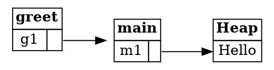

## References Are Pointers

Ownership, boxes, and moves give us a solid foundation for programming with the heap. But move-only code
can be inconvenient. Suppose you want to read two strings twice.

Here's a program that passes two strings to `greet`, and then tries to use them again:

```rust
fn main() {
    let m1 = String::from("Hello");
    let m2 = String::from("world");
    greet(m1, m2);
    let s = format!("{} {}", m1, m2);
}

fn greet(g1: String, g2: String) {
    println!("{} {}!", g1, g2);
}
```

Calling `greet` moves the strings into its parameters. Both are dropped when `greet` ends, so `main` can't
use them afterwards. Rust rejects the program with the error from the moves step:

```text
error[E0382]: borrow of moved value: `m1`
```

The line numbers and the rest of the message may differ, but the meaning is the same. The strings were moved,
and they can't be used any more.

You could get around this by making `greet` return the strings, so that ownership comes back to `main`. But that
style is verbose. Rust has a more convenient tool for this situation: **references**.

---

### References are non-owning pointers

A **reference** is a kind of pointer, and it's written with an ampersand. The expression `&m1` creates a reference
to `m1`, which is called *borrowing* `m1`. The parameters of `greet` change to match:

```rust
fn main() {
    let m1 = String::from("Hello");
    let m2 = String::from("world");
    greet(&m1, &m2);
    let s = format!("{} {}", m1, m2);
}

fn greet(g1: &String, g2: &String) {
    println!("{} {}!", g1, g2);
}
```

Expected output:

```
Hello world!
```

The type `&String` means "a reference to a `String`". Now `main` still owns both strings after the call. Only the
references were passed.

Look at what happens inside `greet`. Its frame holds `g1`, which points to `m1`. And `m1` is a `String`, which
contains a box that points to the characters on the heap. So there are two steps from `g1` to the data:



*Diagram adapted from the [Brown University edition of The Rust Programming Language](https://rust-book.cs.brown.edu/).*

Although `m1` owns the characters "Hello", `g1` owns neither `m1` nor the characters. When `greet` ends, only its
frame disappears. Nothing on the heap is freed, which is what the box deallocation principle predicts. Rust
didn't free "Hello" on behalf of `g1`, because `g1` never owned it.

For that reason, references are called **non-owning pointers**. They point at data, but they don't take responsibility for it.

---

### Dereferencing a pointer accesses its data

The programs so far have used `println!` on both owned `String` values and `&String` references, and it works the
same way for both. The mechanism behind that is the **dereference** operator, written as an asterisk (`*`). It
follows a pointer to the value it points to.

Here's a program that uses dereferences in a few different ways:

```rust
fn main() {
    let mut x: Box<i32> = Box::new(1);
    let a: i32 = *x;        // *x reads the value on the heap, so a = 1
    *x += 1;                // *x on the left modifies the value on the heap, so it becomes 2

    let r1: &Box<i32> = &x; // r1 points to x on the stack
    let b: i32 = **r1;      // two dereferences reach the value on the heap

    let r2: &i32 = &*x;     // r2 points to the heap value directly
    let c: i32 = *r2;       // so only one dereference is needed to read it

    println!("a = {a}, b = {b}, c = {c}");
}
```

Expected output:

```
a = 1, b = 2, c = 2
```

The difference between `r1` and `r2` is worth noticing. `r1` points to `x` on the stack, which in turn points to the
heap, so reading through it takes two dereferences. `r2` points straight at the heap value, so one is enough.

You don't often see the dereference operator in everyday Rust code. Rust inserts dereferences and references
automatically in many places, especially when you call a method with the dot operator. These two calls do the same
thing:

```rust
let x: Box<i32> = Box::new(-1);
let x_abs1 = i32::abs(*x); // explicit dereference
let x_abs2 = x.abs();      // implicit dereference
```

This fragment prints nothing. It shows two equivalent ways of calling the same method.

The same is true for references. Calling `s.len()` on a `String` is the same as `str::len(&s)`, where the reference is
inserted for you. That's why `println!` seems to work with both owned values and references. The dot syntax is
shorthand for the explicit version.

---

### Going further

This step has covered what a reference is, and how to follow one. The next steps cover the rules that keep references
safe, and why a reference can't be used after the data it points to has changed. That's where Rust's borrow checker
comes in.

---

### Try it in the runner

The sample for this step passes references to `greet`, so both strings stay available. Press **F5**. The Output
pane should show:

```
Hello world!
Hello world
```

The comments in `src/main.rs` suggest a change to try. Make `greet` take `String` values, call it with `greet(m1, m2)`,
and see what happens when `m1` is used afterwards.

---

### Quiz

*These questions are adapted from the quizzes in the [Brown University edition of The Rust Programming Language](https://rust-book.cs.brown.edu/).*

````quiz
Consider a program in which `x` is a `Box` holding `0`, and `y` is a `Box` holding a reference to `x`:

```rust
let x = Box::new(0);
let y = Box::new(&x);
```

If you wanted to copy out the number `0` through `y`, how many dereferences would you need? Write your answer as a
digit. For example, if the correct expression is `*y`, then the answer is 1.

[ 3 ]
→ The correct expression is `***y`. `y` is a heap pointer to a stack reference to a heap pointer. Each layer of indirection
needs one dereference, so there are three.
````

````quiz
In this program, why is `v` not deallocated after `get_first` is called?

```rust
fn get_first(vr: &Vec<i32>) -> i32 {
    vr[0]
}

fn main() {
    let mut v = vec![0, 1, 2];
    let n = get_first(&v);
    println!("{} {}", n, v[1]);
}
```

○ `vr` is not mutated within `get_first`
→ Not quite. Mutation isn't what decides whether `v` is freed. Ownership is.
○ `get_first` returns a value of type `i32`, not the vector itself
→ Not quite. The return type matters less than what the function's parameter does with the vector.
◉ `vr` is a reference, which does not own the vector it points to
→ Yes. Passing `&v` doesn't move ownership into `get_first`, so `v` is still owned by `main`, and is freed there.
○ `v` is used after calling `get_first`, in the `println!`
→ Not quite. Using `v` later doesn't keep it alive by itself. The reason is that ownership never moved.
````

---

*For more detail, see section 4.2 "References and Borrowing" in [The Rust Programming Language](https://doc.rust-lang.org/book/ch04-02-references-and-borrowing.html).*
