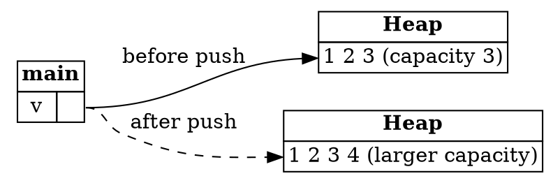

## Aliasing and Mutation

In the last step, references let us read data without taking ownership of it. That's convenient, but
pointers have a serious risk, and it's the reason Rust's rules around references exist.

The risk comes from combining two things. **Aliasing** means accessing the same data through more than one
variable. **Mutation** means changing that data. Aliasing on its own is harmless. Mutation on its own is
harmless. Put them together and one variable can change data that another variable is relying on.

Here's how that can go wrong:

- One variable can deallocate the data while another still points to it.
- One variable can change the data in a way that breaks a property the other variable depends on.
- Two variables can change the same data at the same time, which is a *data race*. The result depends on
  timing, so it can differ from one run to the next.

Keeping these apart is a central job for Rust's safety rules. To see how it works in practice, we need an
example that really does mutate data while it's aliased.

---

### A vector can move its data

The running example in this step is `Vec`, a growable list. Unlike an array, whose length is fixed, a vector
stores its elements on the heap, so it can grow. The `vec!` macro creates a vector from a list of values:

```rust
let mut v: Vec<i32> = vec![1, 2, 3];
v.push(4);
```

This fragment prints nothing. `push` adds an element to the end of the vector. The `mut` is needed, because `push` changes the vector.

A vector allocates a heap array with a certain *capacity*, which is how many elements fit before it needs more
room. Here the capacity is three, and the vector is full. So when `push` adds a fourth element, the vector has to
create a larger allocation, copy the elements across, and free the original array. The new array is usually in a
different place in memory:



*Diagram adapted from the [Brown University edition of The Rust Programming Language](https://rust-book.cs.brown.edu/).*

The diagram shows two possible states of the same vector. Before the push, `v` points to the first array. After
the push, `v` points to a new array, and the first one has been freed.

---

### A reference that outlives a push

Now suppose we took a reference to an element before the push:

```rust
let mut v: Vec<i32> = vec![1, 2, 3];
let num: &i32 = &v[2];
v.push(4);
println!("Third element is {}", *num);
```

This program is rejected by the compiler, as the error further down shows. It's here to explain the undefined behavior the rule prevents.

Here `num` points to the third element of the first array, and `v.push(4)` frees that array. `num` is left
pointing at memory that has been released. Reading `*num` on the last line is reading freed memory, which is
undefined behavior. The dashed arrow in the diagram above is exactly this reference.

The problem isn't that `v` is aliased, or that it's mutated. It's that `num` is aliasing `v` while `v` is being
mutated. The same data is being accessed through two paths at the same time, and one of them changes it.

---

### The pointer safety principle

From this, Rust takes a simple principle:

> **Pointer Safety Principle:** data should never be aliased and mutated at the same time.

Data can be aliased. Data can be mutated. But it can't be both at once. Rust enforces this in different ways for
different kinds of pointer.

For boxes, which are owning pointers, Rust forbids aliasing altogether. Assigning a box to another variable moves
it, and the old variable can no longer be used. An owned value can only be reached through its owner, so there's
never an alias to worry about.

References are different. They're non-owning, and they exist precisely to create aliases, so they can't be banned
outright. Instead, Rust limits them. While a reference is in use, the data it points to can't be mutated through
its owner. When the reference's last use is over, the owner can change the data again.

The rules that enforce this are the job of the **borrow checker**, and the next steps explain how it works. First,
here is what it looks like when it stops a program.

---

### The borrow checker reports the conflict

Here is the unsafe program again, this time as the compiler sees it:

```rust
let mut v: Vec<i32> = vec![1, 2, 3];
let num: &i32 = &v[2];
v.push(4);
println!("Third element is {}", *num);
```

Rust refuses to compile it, with an error like this:

```text
error[E0502]: cannot borrow `v` as mutable because it is also borrowed as immutable
 --> test.rs:4:1
  |
3 | let num: &i32 = &v[2];
  |                  - immutable borrow occurs here
4 | v.push(4);
  | ^^^^^^^^^ mutable borrow occurs here
5 | println!("Third element is {}", *num);
  |                                 ---- immutable borrow later used here
```

The message names three places: where `v` is borrowed, where it's mutably borrowed by `push`, and where the first
borrow is used again. The line numbers may differ. The important part is that the error is about the *borrow*, not
the vector. `num` is the immutable borrow, and it's still in use when `push` needs to change `v`.

The sample for this step is the safe version, where the `println!` that uses `num` comes before the `push`.

---

### Try it in the runner

Press **F5**. The Output pane should show:

```
Third element is 3
Vector is now [1, 2, 3, 4]
```

The comments in `src/main.rs` suggest moving the `println!` that uses `num` to after the `push`. Rust will reject
that, and the error is the one described above. The second suggestion is to print the capacity before and after the
push, to see the vector reallocate.

---

### Quiz

*These questions are adapted from the quizzes in the [Brown University edition of The Rust Programming Language](https://rust-book.cs.brown.edu/).*

````quiz
Does this program compile?

```rust
fn main() {
    let mut s = String::from("hello");
    let s2 = &s;
    let s3 = &mut s;
    s3.push_str(" world");
    println!("{s2}");
}
```

○ This program does compile
→ Not quite. `s2` is an immutable reference to `s`, and it's used after `s3`, a mutable reference, is created and used.
◉ This program does not compile
→ Yes. While `s2` is in use, `s` can't be borrowed mutably. The `push_str` through `s3` would change data that `s2` still points to.
---
On which line does Rust report the problem?

[ 6 ]
→ Yes. Line 6 is the `println!` that uses `s2`. That's the last use of the immutable borrow, which is still live when `s3` is used to change `s`.
````

---

*For more detail, see the section "References and Borrowing" in [The Rust Programming Language](https://doc.rust-lang.org/book/ch04-02-references-and-borrowing.html).*
