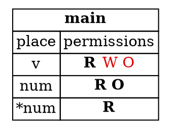
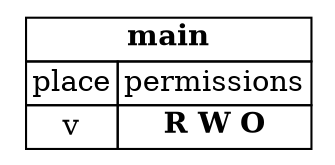

## Permissions

The last step explained the rule: data can't be aliased and mutated at the same time. This step explains how
Rust enforces that rule. The answer is a set of **permissions**, which the compiler tracks for every variable. They
are the tool behind the borrow checker's decisions.

Permissions exist only in the compiler, before the program runs. They don't appear in the compiled program. They
describe how the compiler reasons about each line of your code.

---

### The three permissions

Every variable has up to three kinds of permission on its data:

- **Read** (`R`): the data can be copied to another location.
- **Write** (`W`): the data can be mutated.
- **Own** (`O`): the data can be moved or dropped.

By default, a variable has read and own permissions on its data. If the variable is declared with `let mut`, it
also has write permission. A variable that isn't declared `mut` can't be written, even if it owns its data.

For example, `let mut v: Vec<i32> = vec![1, 2, 3];` gives `v` the read, write, and own permissions. Without `mut`, `v`
would have only read and own.

---

### Borrowing takes permissions away

The key idea is that **references can temporarily remove permissions**. When you borrow data, the borrowed place
gives up some of its permissions, and the reference receives some of its own.

Take the example from the last step. When `num` borrows `v[2]`:

1. `v` loses its write and own permissions. It can still be read, which is why `println!` can use `v`, but it can't
   be mutated or moved while `num` is in use.
2. `num` receives read and own permissions. It isn't writable, because it wasn't declared `mut`.
3. The place `*num`, which is the element `num` points to, gains read permission.

Here's the state at three points, using the example from the last step. Active permissions are shown in bold. Permissions that have been taken away are shown in red.

Before `num` is created, `v` has all three permissions:

```dot
digraph {
    node [shape=plaintext];
    main [label=<<TABLE BORDER="0" CELLBORDER="1" CELLSPACING="0">
        <TR><TD COLSPAN="2"><B>main</B></TD></TR>
        <TR><TD>place</TD><TD>permissions</TD></TR>
        <TR><TD>v</TD><TD><B>R W O</B></TD></TR>
    </TABLE>>];
}
```

While `num` is in use, `v` loses its write and own permissions. `num` has read and own, and `*num` has read:



After `num` is used for the last time, `num` has gone out of use, and `v` has all three permissions again:



*Diagrams adapted from the [Brown University edition of The Rust Programming Language](https://rust-book.cs.brown.edu/). The book's versions are interactive, so these are static copies.*

When `num` is no longer used, the permissions come back. `v` regains its write and own permissions, and the
`push` is allowed. The compiler doesn't care that `num` still exists. It cares whether `num` is *used* later.

---

### Places, not just variables

Permissions belong to *places*, not just to variables. A place is anything that can appear on the left of an
assignment. That includes:

- a variable, such as `a`;
- a dereference, such as `*a`;
- an array access, such as `a[0]`;
- a field of a struct or tuple, such as `a.0`;
- any combination of those.

This matters because a reference can have different permissions from the data it points to. Suppose you declare a
reference that is itself mutable:

```rust
let x = 0;
let mut x_ref = &x;
```

This fragment prints nothing.

`x_ref` has write permission, because it's declared `mut`, so you can assign it a different reference. But `*x_ref`
doesn't have write permission, because the data it points to is behind an immutable reference. You can change where
`x_ref` points, but you can't change the value through it.

---

### Permissions come back when a reference is finished

We said that a reference changes permissions while it's in use. The period during which a reference is in use is its
**lifetime**. It begins where the reference is created, and ends at the last place it is used.

Lifetimes are often contiguous, but control flow can split them. Here's a function that capitalises the first
character of a vector of ASCII characters:

```rust
fn ascii_capitalize(v: &mut Vec<char>) {
    let c = &v[0];
    if c.is_ascii_lowercase() {
        let up = c.to_ascii_uppercase();
        v[0] = up;
    } else {
        println!("Already capitalized: {:?}", v);
    }
}
```

This function prints only when the first character is already capitalised. It's shown to illustrate lifetimes, and
isn't a complete program.

The reference `c` has a different lifetime in each branch of the `if`. In the first branch, `c` is used to compute
`up`, so `v` doesn't get write permission back until after that line. In the `else` branch, `c` is never used, so `v`
regains write permission as soon as that branch begins.

The compiler works this out for each path through the program, not just for the code as it's written.

---

### Using a place after it loses permission

The permissions are the compiler's way of checking the safety rule from the last step. Each operation requires certain
permissions on the place it uses. Reading needs read permission. Writing or pushing needs write permission. Moving or
dropping needs own permission. If a place doesn't have the permission an operation needs, the program is rejected.

This is why the error from the last step appeared. `v.push(4)` needs write permission on `v`, but `num` had taken it
away, because `num` was still in use.

---

### Try it in the runner

The sample for this step uses the borrow from the last step, and the `push` after the last use of `num`. Press **F5**.
The Output pane should show:

```
Third element is 3
Vector is now [1, 2, 3, 4]
```

The comments in `src/main.rs` suggest adding a second use of `num`, before and after the `push`. Only one of those
versions compiles, and the reason is the lifetime of `num`.

---

### Quiz

*These questions are adapted from the quizzes in the [Brown University edition of The Rust Programming Language](https://rust-book.cs.brown.edu/).*

````quiz
Consider this program:

```rust
fn main() {
    let mut s = String::from("Hello");
    let t = &mut s;
    t.push_str(" world");
    println!("{}", s);
}
```

At the point just after `let t = &mut s;` (and before `t.push_str`), which permissions does the path `s` have?

○ Read
→ Not quite. The mutable borrow takes away all of `s`'s permissions while `t` is in use, not just some of them.
○ Write
→ Not quite. `s` loses write permission while `t` is in use, and also every other permission.
○ Own
→ Not quite. `s` loses own permission too, so it can't be moved or dropped while `t` is in use.
◉ No permissions
→ Yes. The mutable borrow `t = &mut s` removes all permissions from `s` while `t` is in use.
````

````quiz
Consider this program:

```rust
fn get_first(v: &Vec<String>) -> &String {
    &v[0]
}

fn main() {
    let mut strs = vec![String::from("A"), String::from("B")];
    let first = get_first(&strs);
    if first.len() > 0 {
        strs.push(String::from("C"));
    }
}
```

Why does `strs` lose and then regain write permission?

○ `strs` is not writable while the immutable reference `&strs` passed to `get_first` is live
→ Close, but the reference is not the whole story. It's `first`, the reference that `get_first` returns, that matters, because it may point into `strs`.
◉ `get_first` returns an immutable reference to data within `strs`, so `strs` is not writable while `first` is live
→ Yes. Rust treats `first` as possibly pointing into `strs`. Once `first` is no longer used after the `if` condition, `strs` regains write permission.
○ `strs` does not need write permission until `push`, so it only regains permission at that statement
→ Not quite. The permission is taken away when `first` is created, not when `push` is reached.
○ Because `first` refers to `strs`, `strs` can only be mutated inside a nested scope such as the `if`
→ Not quite. The `if` does not limit where `strs` can be changed. It's the lifetime of `first` that does.
````

````quiz
Consider this program, which is rejected by the compiler:

```rust
fn main() {
    let v1 = vec![1, 2, 3];
    let mut v2 = v1;
    v2.push(4);
    println!("{}", v1[0]);
}
```

Which of the following best describes the point at which undefined behaviour occurs?

○ `v2` owns the vector data on the heap, while `v1` does not
→ Not quite. That's a true description of the program, but it doesn't explain where the undefined behaviour happens.
○ `v1` has been moved into `v2` on line 3
→ Not quite. That's true, and it's why `v1` can't be used. But the move itself isn't undefined behaviour.
○ `v1` has its pointer invalidated by the `push` on line 4
→ Not quite. `push` acts on `v2`. The pointer that matters is `v1`'s, and it's changed by the move.
◉ `v1[0]` reads `v1`, which points to deallocated memory
→ Yes. Reading `v1` after it has been moved means reading memory that has already been freed. That read is the undefined behaviour.
````

---

*For more detail, see the section "References and Borrowing" in [The Rust Programming Language](https://doc.rust-lang.org/book/ch04-02-references-and-borrowing.html).*
