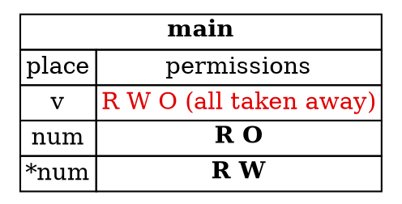

## Mutable References

So far, the references in this sub-chapter have been shared. They let you read data, but not change it. Sometimes
you need to change data without moving it. For that, Rust has **mutable references**, also called unique references.

---

### Creating a mutable reference

A mutable reference is created with `&mut`, and its type is written `&mut T`:

```rust
let mut v: Vec<i32> = vec![1, 2, 3];
let num: &mut i32 = &mut v[2];
*num += 1;
```

This fragment prints nothing. `num` gives temporary access to the third element. Writing `*num += 1` changes `v[2]` through the reference, without
moving or copying the vector. The `mut` on `v` is needed, because `v` is being changed through a borrow of it.

Mutable references differ from shared references in two important ways:

1. **While `num` is in use, `v` has no permissions at all.** A shared reference only took away the write and own
   permissions, and left `v` readable. A mutable reference takes everything away. `v` can't be read, written, or
   moved until `num` is finished with.
2. **`*num` gains write permission.** Through the mutable reference, the data can be changed. `num` itself still
   can't be reassigned to point somewhere else, because `num` wasn't declared `mut`.

While `num` is in use, `v` has no permissions. `num` has read and own, and `*num` has read and write. Active permissions are in bold, and red permissions have been taken away:



*Diagram adapted from the [Brown University edition of The Rust Programming Language](https://rust-book.cs.brown.edu/).*

The first point is what makes mutable references safe. Mutation is allowed, but there is never another path to the
same data at the same time. The borrowed place is temporarily unusable, so it can't act as an alias.

The second point is what makes them useful. The borrow gives exclusive write access to the element, so you can change
it in place.

---

### Downgrading a mutable reference

A mutable reference can be temporarily turned into a shared one. Here, a shared reference is made from the mutable one:

```rust
let mut v: Vec<i32> = vec![1, 2, 3];
let num: &mut i32 = &mut v[2];
let num2: &i32 = &*num;
println!("{} {}", *num, *num2);
```

This fragment is shown for the borrow rules. It isn't a complete program.

The borrow `&*num` removes write permission from `*num`, but leaves read permission in place. So both `*num` and `*num2`
can be read by `println!`, but neither can be written while `num2` is in use.

---

### Why an index borrows the whole vector

You might expect that borrowing one element of a vector would leave the other elements alone. Rust doesn't see it that
way. Indexing a `Vec` borrows the whole vector, because the compiler only sees a call on `v`, not a particular element.
So `&mut v[0]` and `&mut v[2]` at the same time are both borrows of `v`, and they conflict.

This is why the sample comment suggests two mutable references to the same vector, one after the other, cannot
overlap. Rust uses a standard-library function, `split_at_mut`, to split a slice into two parts that can be mutated
separately. You'll see that technique in the slices step.

---

### Mutable references and the reference you didn't mark `mut`

A common mistake is to mark the variable `mut` and forget the borrow. Here is a function that tries to increase a number:

```rust
fn incr(n: &mut i32) {
    *n += 1;
}

fn main() {
    let mut n = 1;
    incr(&n);
    println!("{n}");
}
```

This program is rejected by the compiler, as explained below. Changing the call to `incr(&mut n)` makes it compile, and
the program then prints `2`.

The variable `n` is declared `mut`, but the call passes `&n`, a shared reference. `incr` expects `&mut i32`, so the
program is rejected. A valid version says `incr(&mut n)`. The `mut` on the variable allows the mutable borrow, and the
`mut` in `&mut` is what requests it. Both are needed.

---

### Try it in the runner

Press **F5** to run the sample. The Output pane should show:

```
Third element is 4
Vector is now [1, 2, 4]
```

The comments in `src/main.rs` suggest two changes. The first is to switch to a shared reference, which breaks the line
that changes the value. The second is to borrow a different element mutably while the first borrow is still needed, which
is rejected for the reason described above.

---

### Quiz

*These questions are adapted from the quizzes in the [Brown University edition of The Rust Programming Language](https://rust-book.cs.brown.edu/).*

````quiz
Does this program compile?

```rust
fn incr(n: &mut i32) {
  *n += 1;
}

fn main() {
  let mut n = 1;
  incr(&n);
  println!("{n}");
}
```

○ This program does compile
→ Not quite. `incr` takes a mutable reference, but `&n` is a shared reference, so the call is rejected.
◉ This program does not compile
→ Yes. Although `n` is declared `mut`, the reference passed to `incr` must be mutable too, written `&mut n`.
---
On which line does Rust report the problem?

[ 7 ]
→ Yes. Line 7 is the call `incr(&n)`, which passes a shared reference where a mutable one is required.
````

````quiz
Consider this function, which pushes onto a vector and then removes the first element:

```rust
fn give_and_take(v: &Vec<i32>, n: i32) -> i32 {
    v.push(n);
    v.remove(0)
}
```

Normally the compiler rejects this function, because `v` is a shared reference, but `push` needs a mutable one. Assume
the compiler did not reject it. Which of these programs could cause undefined behavior if executed?

○ `let v = vec![1, 2, 3]; let v2 = &v; give_and_take(&v, 4); println!("{}", v2[0]);`
→ Not quite. A reference to the whole vector `v` is not made invalid by changing the vector's contents, so reading through `v2` is safe.
○ `let v = vec![1, 2, 3]; let k = give_and_take(&v, 4); println!("{}", k);`
→ Not quite. This program never uses an invalidated reference. It only prints a plain number that was returned.
◉ `let v = vec![1, 2, 3]; let n = &v[0]; give_and_take(&v, 4); println!("{}", n);`
→ Yes. `push` can reallocate the vector's storage, so `n`, which points at an element, can end up pointing at freed memory.
○ None of these programs could cause undefined behavior
→ Not quite. The third program reads a reference that the push can invalidate.
````

---

*For more detail, see the section "Mutable References" in [The Rust Programming Language](https://doc.rust-lang.org/book/ch04-02-references-and-borrowing.html).*
