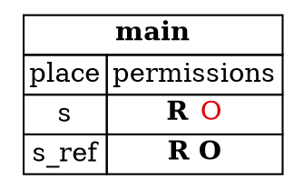
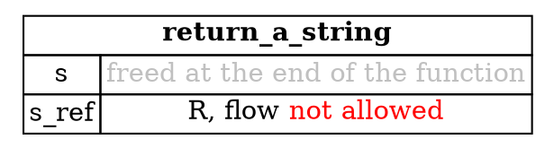

## Data Must Outlive Its References

The borrow checker enforces the pointer safety principle in another way too. Data must outlive every reference to it.
If the data is freed while a reference still points to it, the reference leads to invalid memory. This step explains how
Rust prevents that, and why the rules change when a reference crosses a function boundary.

---

### Dropping data while a reference is live

First, the simpler case, where a reference and its data are both in one function. Say we try to drop a string while
still holding a reference to it:

```rust
fn main() {
    let s = String::from("Hello world");
    let s_ref = &s;
    drop(s);
    println!("{}", s_ref);
}
```

This program is rejected by the compiler, as explained below.

The borrow `&s` removes the own permission from `s`, because a reference is not allowed to own the data. But `drop`
needs to own its argument, because dropping means freeing it. So the program asks for a permission that `s` doesn't
have at that point, and it's rejected. Dropping `s` would leave `s_ref` pointing at freed memory.

Within a single function, the compiler knows how long `s_ref` lives, so it can check this using permissions alone.

At the point of `drop(s)`, `s` has lost its own permission to the borrow, and `s_ref` still needs the value. Active permissions are in bold, and red permissions have been taken away:



*Diagram adapted from the [Brown University edition of The Rust Programming Language](https://rust-book.cs.brown.edu/).*

---

### References in and out of functions

The compiler can't always see the whole lifetime of a reference. It can't do that when a reference is passed into a
function, or returned from one. Here is a safe function that returns a reference to the first element of a vector:

```rust
fn first(strings: &Vec<String>) -> &String {
    let s_ref = &strings[0];
    s_ref
}
```

This function isn't a complete program, and it compiles on its own. It's the signature that matters here.

This is safe, because the returned reference points into data the caller owns. But the compiler has to check this
without knowing what the caller will do afterwards, so it uses a different tool here: the **flow permission**.

The flow permission describes whether a reference is allowed to *flow* into a particular place, such as being returned
from the function. Unlike read, write, and own, the flow permission doesn't change as the function runs. It's about
where a reference is permitted to go. A reference flows out of a function only if it refers to data that outlives the
function call.

---

### Why a signature must say where a returned reference comes from

Now consider a function with two reference inputs:

```rust
fn first_or(strings: &Vec<String>, default: &String) -> &String {
    if strings.len() > 0 {
        &strings[0]
    } else {
        default
    }
}
```

This doesn't compile. Rust gives this error:

```text
error[E0106]: missing lifetime specifier
  |
1 | fn first_or(strings: &Vec<String>, default: &String) -> &String {
  |                      ------------           -------     ^ expected named lifetime parameter
  |
  = help: this function's return type contains a borrowed value, but the signature does not say whether it is borrowed from `strings` or `default`
```

The phrase "missing lifetime specifier" sounds mysterious, but the help message explains it. From the signature alone,
Rust can't tell whether the returned reference comes from `strings` or from `default`. That matters for the caller. If
the returned reference could come from `default`, then a caller who dropped `default` while holding the result would
leave it pointing at freed memory.

Rust needs to be certain that `default` can't flow into the return value, and the signature as written doesn't say so.

Rust provides a way to write that down, called **lifetime parameters**. They are the subject of Chapter 10, in the
section "Validating References with Lifetimes". For now, it's enough to know two things. References passed into or out of
functions are treated differently from references inside a function body, and Rust uses the flow permission to check them.

---

### A reference to a local value cannot be returned

The same rule explains why a function can't return a reference to something it created:

```rust
fn return_a_string() -> &String {
    let s = String::from("Hello world");
    let s_ref = &s;
    s_ref
}
```

This function doesn't compile. It's shown to explain the error.

The value of `s` is freed when the function ends, so the reference has nothing to refer to. The reference doesn't have the flow permission it would need to leave the function:



*Diagram adapted from the [Brown University edition of The Rust Programming Language](https://rust-book.cs.brown.edu/).*

`s` is freed when `return_a_string` returns, so the reference would point at freed memory. Rust rejects the function
with the same kind of "missing lifetime specifier" error, because `s_ref` doesn't have the flow permission it would need
to leave the function.

---

### Try it in the runner

The sample for this step returns a reference from `first`, and uses it while the vector is still alive. Press **F5**.
The Output pane should show:

```
First: Ferris
```

The comments in `src/main.rs` suggest two things to try. The first is to drop the vector while the reference is still
needed, which the drop rule rejects. The second is to return a reference to a value created inside the function, which
the flow rule rejects.

---

*For more detail, see the section "References and Borrowing" in [The Rust Programming Language](https://doc.rust-lang.org/book/ch04-02-references-and-borrowing.html).*
