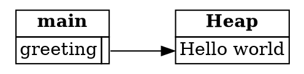

## Returning a Reference to the Stack

Learning to fix an ownership error is a core Rust skill. When the borrow checker rejects your code, the
first question is not "how do I make the error go away?" It's "is my program actually safe?" The answer
decides what kind of fix you need.

This step looks at the first of several case studies, and it applies the lesson from the last section.

---

### The error

Here's a function that tries to return a reference to a string it has just created:

```rust,ignore
fn return_a_string() -> &String {
    let s = String::from("Hello world");
    &s
}
```

Rust rejects it with an error like this:

```text
error[E0106]: missing lifetime specifier
 --> src/main.rs:1:25
  |
1 | fn return_a_string() -> &String {
  |                         ^ expected named lifetime parameter
  |
  = help: this function's return type contains a borrowed value, but there is no value for it to be borrowed from
```

The message is about lifetimes, which the last section introduced. The reason is that `s` is freed when the
function returns, so a reference to it would point at freed memory. That's undefined behavior, so this program
is *unsafe*.

---

### Why is the program unsafe?

When you're fixing this kind of error, ask why the program is unsafe. Here the issue is the lifetime of the
data. If you want to pass around a reference to a string, the string has to live long enough for the reference to
be used.

There are four common ways to make that happen. Each one changes who owns the string, or where it lives. The code for each fix is a fragment: it shows the changed function, not a complete program, so it has no output of its own.

**1. Move ownership out of the function.** Return the `String` itself, so the caller owns it:

```rust,ignore
fn return_a_string() -> String {
    let s = String::from("Hello world");
    s
}
```

This is the sample for this step. The caller now owns the string, and it's freed when the caller is done with it.

**2. Return a string literal.** A string literal lives for the whole program, which is written as `'static`. This
works if the string never needs to change, and then no heap allocation is needed:

```rust,ignore
fn return_a_string() -> &'static str {
    "Hello world"
}
```

**3. Use a reference-counted pointer.** `Rc<T>` lets several owners share a value. The data is freed when the
last owner is dropped:

```rust,ignore
use std::rc::Rc;

fn return_a_string() -> Rc<String> {
    let s = Rc::new(String::from("Hello world"));
    Rc::clone(&s)
}
```

`Rc::clone` copies only the pointer, not the string itself. At runtime, the `Rc` counts its owners, and frees the
data when the count reaches zero. The book covers `Rc<T>` in Chapter 15.

**4. Let the caller provide the space.** The caller creates the string, and the function fills it in through a
mutable reference:

```rust,ignore
fn return_a_string(output: &mut String) {
    output.replace_range(.., "Hello world");
}
```

This style can be verbose, but it's useful when the caller needs to control exactly when allocations happen.

---

### Choosing a fix

Which fix is right depends on the application. The key idea is to recognize the root problem underneath the
surface error. Ask yourself:

* How long should the string live?
* Who should be in charge of freeing it?

Once you have a clear answer to those questions, changing the function's signature to match is usually
straightforward.

---

### The stack and the caller

The first fix works because ownership passes out of the function before its frame is removed. The diagram shows the
state after `return_a_string` has returned and its frame has gone:



*Diagram adapted from the [Brown University edition of The Rust Programming Language](https://rust-book.cs.brown.edu/).*

The frame for `return_a_string` is gone, but its string was never freed. It lives on in `greeting`, which now owns it.

---

### Try it in the runner

The sample for this step is the first fix. Press **F5**. The Output pane should show:

```
Hello world
```

The comments in `src/main.rs` suggest two changes: returning a `&'static str` instead, and taking a `&mut String`
from the caller. Try each one, and see how `main` has to change.

---

### Quiz

*These questions are adapted from the quizzes in the [Brown University edition of The Rust Programming Language](https://rust-book.cs.brown.edu/).*

````quiz
Which of the following is NOT a valid kind of fix to the issue of returning a stack reference from a function?

○ Use a reference-counted pointer
→ This is a valid fix. `Rc<T>` lets the data outlive the function, because it's freed only when the last owner is dropped.
○ Take ownership of the returned value
→ This is a valid fix. Returning the `String` itself moves ownership to the caller.
○ Expect a mutable slot from the caller
→ This is a valid fix. The caller provides the space, and the function fills it in.
◉ Extend the lifetime of the stack frame
→ Yes, this is the one that isn't valid. A stack frame can't have its lifetime extended, so the data must live somewhere other than the frame.
````

---

*For more detail, see section 4.3 "Fixing Ownership Errors" in [The Rust Programming Language](https://doc.rust-lang.org/book/ch04-03-fixing-ownership-errors.html).*
