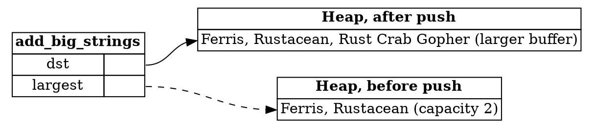

## Aliasing and Mutating a Collection

The last step was about asking for too much permission. This one is about a reference that outlives a change to the
data it points to. The function gets a reference to the largest string in a vector, then uses it while adding to the
vector.

---

### The error

Here's the function, written with a reference to the largest string:

```rust,ignore
fn add_big_strings(dst: &mut Vec<String>, src: &[String]) {
    let largest: &String = dst.iter().max_by_key(|s| s.len()).unwrap();
    for s in src {
        if s.len() > largest.len() {
            dst.push(s.clone());
        }
    }
}
```

The borrow checker rejects it. The line `let largest = ...` takes away the write permission on `dst`, but `dst.push(..)`
needs that permission back.

---

### Is the program unsafe?

Yes. `dst.push(..)` could reallocate the vector's storage, which would deallocate the contents of `dst`. Then `largest`
would refer to freed memory. So the program is unsafe, and the borrow checker is right to stop it.

---

### The fix

The key insight is that the lifetime of `largest` must not overlap with the `push`. Once `largest` has been used for
its last comparison, the vector can change. There are several ways to arrange that.

**Clone `largest`.** This keeps the code close to the original, but allocates and copies a string that is only needed
for its length.

**Compare all lengths first, then change `dst`.** This also works, but it allocates a whole new vector of strings to add.

**Copy out the length.** The function never needs the contents of `largest`, only its length. Copying that number out
gives `largest` a short lifetime, and it's the most idiomatic and efficient choice. This is the sample for this step.

```rust,ignore
fn add_big_strings(dst: &mut Vec<String>, src: &[String]) {
    let largest_len: usize = dst.iter().max_by_key(|s| s.len()).unwrap().len();
    for s in src {
        if s.len() > largest_len {
            dst.push(s.clone());
        }
    }
}
```

All of these fixes share one idea: shorten the lifetime of the borrow on `dst`, so that it doesn't overlap with any
change to `dst`.

---

### Why the vector can move

The diagram shows why the original reference is dangerous. Before the `push`, `largest` points into the vector's buffer.
After the `push`, the vector has moved to a larger buffer, and the old one has been freed:



*Diagram adapted from the [Brown University edition of The Rust Programming Language](https://rust-book.cs.brown.edu/).*

The dashed arrow is `largest`, which now points at the old buffer, which has been freed. That is the undefined behavior
the borrow checker prevents.

---

### Try it in the runner

Press **F5**. The Output pane should show:

```
["Ferris", "Rustacean", "Rust Crab Gopher"]
```

The comments in `src/main.rs` suggest bringing back the reference to `largest`. Rust will reject the `push`, and the
error explains which borrow is still in use.

---

*For more detail, see section 4.3 "Fixing Ownership Errors" in [The Rust Programming Language](https://doc.rust-lang.org/book/ch04-03-fixing-ownership-errors.html).*
