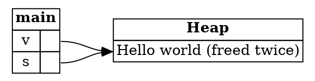

## Copying and Moving Out of a Collection

A common source of confusion for Rust learners is copying a value out of a collection, such as a vector. Some values
can be copied, and some can't, and the difference is about heap data.

---

### A safe copy

Here's a program that copies a number out of a vector through a reference:

```rust,ignore
let v: Vec<i32> = vec![0, 1, 2];
let n_ref: &i32 = &v[0];
let n: i32 = *n_ref;
```

The dereference `*n_ref` needs only the read permission, and the path `*n_ref` has it. This program compiles.

---

### The same program with a String

Change the elements from `i32` to `String`, and the program no longer compiles:

```rust,ignore
let v: Vec<String> = vec![String::from("Hello world")];
let s_ref: &String = &v[0];
let s: String = *s_ref;
```

Rust rejects it with this error:

```text
error[E0507]: cannot move out of `*s_ref` which is behind a shared reference
```

The vector `v` owns the string. Dereferencing `s_ref` would try to take that ownership out of the vector, through a
reference. References are non-owning pointers, so Rust doesn't let you take ownership *through* one.

---

### Why is this unsafe?

Imagine Rust allowed the move. Then `v` and `s` would both think they own "Hello world". When `s` is dropped, the string is
freed. When `v` is dropped, the string is freed again. That's a **double-free**, which is undefined behavior.

The diagram shows the state after the rejected move, if it had been allowed:



*Diagram adapted from the [Brown University edition of The Rust Programming Language](https://rust-book.cs.brown.edu/).*

Both `v` and `s` point to the same heap data, and neither should be the only owner. That is why the move is rejected.

---

### Why `i32` is different

A `String` owns heap data, but an `i32` doesn't. Copying a `String` copies the pointer to the heap, so two owners would
result. Copying an `i32` copies the number itself, and there's nothing on the heap to share.

In technical terms, `i32` implements the `Copy` trait, and `String` doesn't. The rule to remember is:

* An `i32` does not own heap data, so it can be copied without a move.
* A `String` does own heap data, so it can't be copied without a move.
* An `&String` does not own heap data, so the reference itself can be copied.

---

### Safe ways to get a String out of a vector

There are three common ways to work with a `String` in a vector without taking ownership through a reference:

1. **Use an immutable reference**, if you only need to read the string.
2. **Clone the string**, if you want your own copy, and leave the vector alone.
3. **Remove it from the vector** with `Vec::remove`, if you want to take ownership and the vector no longer needs it.

The sample for this step uses the second option.

---

### Try it in the runner

Press **F5**. The Output pane should show:

```
0
Hello world!
```

The comments in `src/main.rs` suggest replacing the clone with `*word_ref`. Rust rejects that change for the reason described
above.

---

### Quiz

*These questions are adapted from the quizzes in the [Brown University edition of The Rust Programming Language](https://rust-book.cs.brown.edu/).*

````quiz
Which of the following best explains why an `i32` can be copied without a move, but a `String` cannot?

○ An `i32` is smaller in memory than a `String`
→ Not quite. Size isn't the reason. If a `String` could be copied without a move, two owners would share its heap data.
○ An `i32` is a primitive type in Rust, while a `String` is not
→ Not quite. Being primitive doesn't decide it. What matters is whether the value owns heap data.
○ A `String` can be placed on the heap, while an `i32` can only be placed on the stack
→ Not quite. Both live on the stack. A `String` also owns data on the heap, which is the important difference.
◉ A `String` owns data on the heap, while an `i32` does not
→ Yes. Copying a `String` would copy its pointer, so two variables would think they own the same data.
````

````quiz
The following code snippet does not compile:

```rust
let s = String::from("Hello world");
let s_ref = &s;
let s2 = *s_ref;
println!("{s2}");
```

Which of the following best describes the undefined behavior that could occur if this program were allowed to execute?

○ The read of `s2` in `println` is a use of freed memory
→ Not quite. The `println` is technically safe, since the string is not deallocated until the end of the current scope.
○ The dereference `*s_ref` is a use of freed memory
→ Not quite. Reading through `s_ref` is fine at that point. The problem comes later.
◉ The string is freed twice at the end of the program
→ Yes. After `s2` takes ownership, both `s` and `s2` are dropped, and the string is freed on behalf of each.
○ There is no undefined behavior in this program
→ Not quite. Both variables would free the same string, which is undefined behavior.
````

---

*For more detail, see section 4.3 "Fixing Ownership Errors" in [The Rust Programming Language](https://doc.rust-lang.org/book/ch04-03-fixing-ownership-errors.html).*
