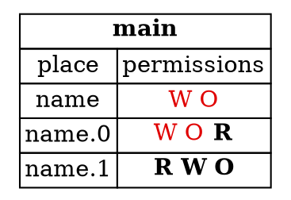

## Safe Programs the Borrow Checker Rejects

The earlier steps were about unsafe programs, which Rust must reject. Rust also rejects some programs that are
*safe*. In those cases, the program is fine, but the borrow checker's view of it is too coarse. This step looks at two
common examples, and at how to work around them.

---

### Tuples: borrowing one field

Rust tracks permissions for each field of a tuple separately. This program borrows one field and writes to another,
and it compiles:

```rust,ignore
let mut name = (String::from("Ferris"), String::from("Rustacean"));
let first = &name.0;
name.1.push_str(", Esq.");
println!("{first} {}", name.1);
```

The borrow `&name.0` takes away write and own permissions from `name.0`. It also takes them away from `name`
as a whole, so you can't pass `name` to a function expecting the whole tuple. But `name.1` keeps its write permission,
so `name.1.push_str(..)` is allowed.

The permissions at the point of `let first` are shown in the diagram below. Active permissions are in bold, and red
permissions have been taken away:



*Diagram adapted from the [Brown University edition of The Rust Programming Language](https://rust-book.cs.brown.edu/).*

---

### When Rust loses track of a field

Rust can lose track of which fields are borrowed. Move the borrow into a function, and the program is rejected:

```rust,ignore
fn get_first(name: &(String, String)) -> &String {
    &name.0
}

fn main() {
    let mut name = (String::from("Ferris"), String::from("Rustacean"));
    let first = get_first(&name);
    name.1.push_str(", Esq.");
    println!("{first} {}", name.1);
}
```

Rust reports:

```text
error[E0502]: cannot borrow `name.1` as mutable because it is also borrowed as immutable
```

This is strange, because the program is safe, and the refactoring doesn't change its behaviour. The reason is that Rust
doesn't look inside `get_first` when it decides what `get_first(&name)` borrows. It only looks at the signature, which says
a `String` from the input is borrowed. So it conservatively assumes both fields are borrowed.

The program is safe, and a future version of Rust might accept it. For now, you can work around the limitation by
writing the expression `&name.0` inline, as in the first version, or by using cells, which the book covers later.

---

### Arrays: all indexes are one place

Rust doesn't keep separate places for `a[0]`, `a[1]`, and so on. It uses one place, `a[_]`, for all indexes. This is because
it often can't know the value of an index at compile time.

For example, this program is safe, but Rust rejects it:

```rust,ignore
let mut a = [0, 1, 2, 3];
let x = &mut a[1];
let y = &a[2];
*x += *y;
```

The mutable borrow `&mut a[1]` takes the whole place `a[_]`, so `&a[2]` is rejected, even though it refers to a different element.

The standard library provides a function that can split an array into two parts, which can then be borrowed separately:

```rust,ignore
let mut a = [0, 1, 2, 3];
let (a_l, a_r) = a.split_at_mut(2);
let x = &mut a_l[1];
let y = &a_r[0];
*x += *y;
```

This is the sample for this step, along with the tuple example. The `split_at_mut` function contains an `unsafe` block
inside the standard library. The borrow checker can't see that the two halves are disjoint, so the unsafe code is
the only way to write it. Unsafe code is covered in Chapter 19.

The general strategy is this: if the borrow checker rejects a program you think is safe, look for a standard library
function that already solves the problem.

---

### Try it in the runner

Press **F5**. The Output pane should show:

```
Ferris Rustacean, Esq.
[0, 3, 2, 3]
```

The comments in `src/main.rs` suggest removing the split and reading `a[2]` directly. Rust rejects that for the reason
described above.

---

### Quiz

*These questions are adapted from the quizzes in the [Brown University edition of The Rust Programming Language](https://rust-book.cs.brown.edu/).*

````quiz
The following program does not compile:

```rust
fn copy_to_prev(v: &mut Vec<i32>, i: usize) {
  let n = &mut v[i];
  *n = v[i - 1];
}
fn main() {
  let mut v = vec![1, 2, 3];
  copy_to_prev(&mut v, 1);
}
```

Which of the following best describes the undefined behavior that could occur if this program were allowed to execute?

○ The assignment `*n` is a use of freed memory
→ Not quite. Nothing is freed here, so there is no freed memory to use.
○ The borrow `&mut v[i]` creates a pointer to freed memory
→ Not quite. The vector is not reallocated by the borrow, so the pointer is valid.
○ The read of `v[i - 1]` is a use of freed memory
→ Not quite. The vector is still alive, and the read is of an element within it.
◉ There is no undefined behavior in this program
→ Yes. The program is safe. If `i` were out of bounds, Rust would panic at runtime, not cause undefined behaviour. The borrow checker rejects it because it can't tell that `v[i]` and `v[i - 1]` are different elements.
````

````quiz
What does this program print?

```rust
fn main() {
    let mut point = [0, 1];
    let mut x = point[0];
    let y = &mut point[1];
    x += 1;
    *y += 1;
    println!("{} {}", point[0], point[1]);
}
```

[ 0 2 ]
→ Yes. The binding of `x` copies `point[0]`, so `x += 1` doesn't change the array. The mutable borrow of `point[1]` is then
changed by `*y += 1`, so the result is `0 2`.
````

---

*For more detail, see section 4.3 "Fixing Ownership Errors" in [The Rust Programming Language](https://doc.rust-lang.org/book/ch04-03-fixing-ownership-errors.html).*
