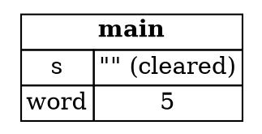

## The Index Problem

Sometimes a function needs to return part of a string. The natural first attempt is to return the position where
the part ends. That approach has a hidden flaw, and this step shows what it is. The next steps show how slices solve it.

The problem is this: write a function that takes a string of words separated by spaces, and returns the first word.
If there's no space, the whole string is one word, so return the whole string.

---

### A first attempt

The function can find the end of the first word by looking for a space. It returns the position of that space, which is
an index:

```rust,ignore
fn first_word(s: &String) -> usize {
    let bytes = s.as_bytes();

    for (i, &item) in bytes.iter().enumerate() {
        if item == b' ' {
            return i;
        }
    }

    s.len()
}
```

The function takes a `&String`, which is fine, since it only needs to read the string. It converts the string into bytes
with `as_bytes`, then looks through them with `iter` and `enumerate`. `enumerate` gives each byte together with its index,
so the function can return the position of the first space.

---

### The index can go out of sync

Here's a program that uses the index:

```rust,ignore
fn main() {
    let mut s = String::from("hello world");
    let word = first_word(&s);
    s.clear();
}
```

This program compiles. The index is stored in `word`, which is a separate value from `s`. Nothing connects them. So when
`s.clear()` empties the string, `word` still holds `5`, and nothing warns us that `5` no longer means anything.

The diagram shows the two values after `clear`. `word` holds a number, and `s` no longer has a word in it:



*Diagram adapted from the [Brown University edition of The Rust Programming Language](https://rust-book.cs.brown.edu/).*

The 5 is a meaningful number only in the context of the string as it was before `clear`. Once the string changes, the 5
is a stale value.

---

### Why this gets worse

Keeping an index in step with the data is tedious and easy to get wrong. It gets worse with more complex functions. A
`second_word` function would need to return a starting index and an ending index:

```rust,ignore
fn second_word(s: &String) -> (usize, usize) {
```

Now there are two related numbers, and both must stay in step with the string. With more of them, you have several
unrelated variables that all need to be kept in sync with the same data, and none of them is connected to the data
at all.

The sample for this step is the program with the index, showing the problem in action. The next step introduces
string slices, which fix it.

---

### Try it in the runner

Press **F5**. The Output pane should show:

```
The index is 5, but the string is now ''
```

The index still says 5, but the string it described is empty. The comments in `src/main.rs` suggest printing the first word
before the `clear`, and then changing the text while keeping the index. Both show how easily the index and the string can
drift apart.

---

*For more detail, see section 4.4 "The Slice Type" in [The Rust Programming Language](https://doc.rust-lang.org/book/ch04-04-slices.html).*
