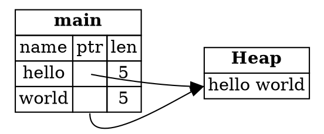

## String Slices

A *string slice* is a reference to part of a `String`. It's written with a range in square brackets, and it's the
answer to the problem in the last step. Instead of returning a number that has to be kept in sync with the string, you
return a reference to the part you mean.

---

### Creating a slice

```rust,ignore
let s = String::from("hello world");

let hello: &str = &s[0..5];
let world: &str = &s[6..11];
```

`hello` is a reference to the first five bytes of `s`, and `world` is a reference to the bytes from index 6 up to, but not
including, index 11. The range is written `[start..end]`. The `start` is the first position in the slice, and `end` is one
more than the last position.

The type `&str` is the string slice type. You'll see it often in function signatures.

The sample for this step prints both slices:

```
hello world
```

---

### A slice is a fat pointer

A slice is a *fat pointer*. A plain reference, such as `&String`, is just a pointer. A slice is a pointer together with
its length, so it carries extra information. The diagram shows `hello` and `world` as slices into the same heap string:



*Diagram adapted from the [Brown University edition of The Rust Programming Language](https://rust-book.cs.brown.edu/).*

Each slice points at its own part of the heap data, and carries its own length. Nothing needs to be kept in sync separately,
because the slice's length and its pointer belong together.

---

### Size: a slice is bigger than a plain reference

The sample prints the size of each kind of reference:

```
8 16
```

On a 64-bit computer, `&String` takes 8 bytes, because it's a single pointer. `&str` takes 16 bytes, because it's a pointer and
a length. This is the difference the book's quiz asks about: the slice `s3` of type `&str` uses more stack memory than the
reference `s2` of type `&String`, even though both point into the same string.

The sizes depend on the computer. On a 32-bit computer the numbers would be smaller, but the slice would still be twice
the size of the plain reference.

---

### Range syntax

If a slice starts at the beginning of the string, you can leave out the start index. If it runs to the end, you can leave out
the end index. These pairs are equal:

```rust,ignore
let s = String::from("hello");

let slice = &s[0..2];
let slice = &s[..2];

let len = s.len();
let slice = &s[3..len];
let slice = &s[3..];

let slice = &s[0..len];
let slice = &s[..];
```

String slice indices must fall on valid UTF-8 character boundaries. If you try to start or end a slice in the middle of a
multi-byte character, the program stops with an error. The examples in this section assume ASCII text, where each character
is one byte.

---

### Try it in the runner

Press **F5**. The Output pane should show:

```
hello world
8 16
```

The comments in `src/main.rs` suggest changing the range, and using an empty start index. Try each one, and see how the
slice changes.

---

### Quiz

*These questions are adapted from the quizzes in the [Brown University edition of The Rust Programming Language](https://rust-book.cs.brown.edu/).*

````quiz
Consider the variables `s2` and `s3` in the following program. These two variables will be located in memory within the stack
frame for `main`. Each variable has a size in memory on the stack, *not* including the size of pointed data. Which statement
is true about the sizes of `s2` and `s3`?

```rust
fn main() {
  let s = String::from("hello");
  let s2: &String = &s;
  let s3: &str = &s[..];
}
```

○ `s3` has the same number of bytes as `s2`
→ Not quite. `s2` is a single pointer, but `s3` is a pointer and a length, so it's bigger.
○ `s3` has fewer bytes than `s2`
→ Not quite. A slice carries a length as well as a pointer, so it's never smaller than a plain reference.
◉ `s3` has more bytes than `s2`
→ Yes. `&String` is one pointer, 8 bytes on a 64-bit computer. `&str` is a pointer and a length, 16 bytes.
````

---

*For more detail, see section 4.4 "The Slice Type" in [The Rust Programming Language](https://doc.rust-lang.org/book/ch04-04-slices.html).*
