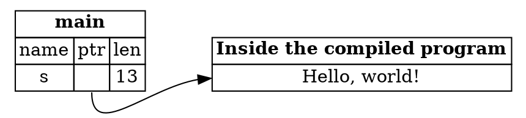

## Slices as Parameters

The first step of this section used `&String` as the parameter type. There's a more general choice, which is to use
`&str`. The result is a function that works with both `String` values and string literals, with no change to its body.

---

### The better signature

```rust,ignore
fn first_word(s: &str) -> &str {
```

Because the parameter is a slice, the function doesn't care where the text lives. A string slice can point into a `String`
on the heap, or into a string literal stored inside the program. The function only needs to read the bytes, so it takes the
slice that describes them.

This is the version of `first_word` in the sample for this step.

---

### Calling it with different kinds of text

The sample calls `first_word` in three ways:

```rust,ignore
let my_string = String::from("hello world");
first_word(&my_string[..]);     // a slice of a String
first_word(&my_string);         // a reference to a String

let my_string_literal = "hello world";
first_word(my_string_literal);  // a string literal, which is already a &str
```

All three print the same word:

```
hello
hello
hello
```

The second call works because of *deref coercion*. Rust turns a `&String` into a `&str` automatically, when the function
expects a `&str`. The book covers deref coercion in Chapter 15. For now, it's enough to know that the call reads naturally, and
the compiler does the conversion for you.

---

### String literals are slices

A string literal has the type `&str`. Here's a string literal, and the diagram shows where it lives:

```rust,ignore
let s = "Hello, world!";
```

The variable `s` is a slice pointing to a fixed place inside the compiled program. That's why string literals are
immutable. A `&str` is an immutable reference, so you can read the text, but you can't change it through the slice.



*Diagram adapted from the [Brown University edition of The Rust Programming Language](https://rust-book.cs.brown.edu/).*

The text is not on the stack or the heap. It's part of the program itself, which is why the slice's pointer leads there.

---

### Try it in the runner

Press **F5**. The Output pane should show:

```
hello
hello
hello
```

The comments in `src/main.rs` suggest passing a `String` directly, without the `&`. Rust rejects that, because `first_word`
expects a reference to text, not an owned `String`.

---

*For more detail, see section 4.4 "The Slice Type" in [The Rust Programming Language](https://doc.rust-lang.org/book/ch04-04-slices.html).*
