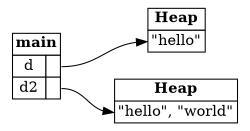

## Ownership versus Garbage Collection

This chapter introduced a lot of new ideas: ownership, borrowing, slices, the stack and the heap, pointers, and undefined
behaviour. Before moving on, this recap reviews the main ideas, and puts ownership in context.

Most languages you may know use a *garbage collector*. It runs alongside the program, finds memory that the program can
no longer reach, and frees it. Python, JavaScript, Java, and Go all work this way.

A garbage collector has real benefits. It prevents undefined behaviour, such as using freed memory, which can happen in
C and C++. It also means the compiler doesn't need a complex type system to check for it, as Rust does. But there are
two drawbacks. The first is performance: a garbage collector adds overhead while the program runs. The second is less
obvious: **garbage collection can be unpredictable**, and it can hide what data a variable is connected to.

---

### A Python example

Here is a `Document` type in Python. It's a mutable list of words:

```python
class Document:
    def __init__(self, words: List[str]):
        """Create a new document"""
        self.words = words

    def add_word(self, word: str):
        """Add a word to the document"""
        self.words.append(word)

    def get_words(self) -> List[str]:
        """Get a list of all the words in the document"""
        return self.words
```

Now use it to create a document `d`, copy it into a new document `d2`, and change `d2`:

```python
words = ["Hello"]
d = Document(words)

d2 = Document(d.get_words())
d2.add_word("world")
```

Two questions are worth asking about this example. The first is when the `words` list is freed. Three variables point at
the same list, so Python frees it only once all three are out of scope, which is hard to predict from reading the code.

The second question matters more. What are the words in `d`? Because `get_words` returns a reference to the list inside
`d`, the change to `d2` also changes `d`. So `d` now holds `["Hello", "world"]`. Nothing in the code makes that obvious.
This problem is not unique to Python. The underlying behaviour is pointers, and most languages have them. What differs is
how visible they are.

*The Python examples are for comparison only, and aren't Rust programs. They're adapted from the Brown University edition of The Rust Programming Language.*

---

### The same design in Rust

Rust puts pointers front and centre. Here is the same `Document`, written with a type alias for the vector:

```rust,ignore
type Document = Vec<String>;

fn new_document(words: Vec<String>) -> Document {
    words
}

fn add_word(this: &mut Document, word: String) {
    this.push(word);
}

fn get_words(this: &Document) -> &[String] {
    this.as_slice()
}
```

Each signature says something about ownership:

* `new_document` takes ownership of the vector, so the document owns it. The vector is freed when its document is.
* `add_word` takes a mutable reference, so it's clear that it changes the document.
* `get_words` returns a shared reference to the words, so the caller can read them, but can't change them.

The only way to get an independent copy of the words is to clone them explicitly. The sample for this step does exactly that,
with `to_vec`, which clones each word:

```
d: ["hello"]
d2: ["hello", "world"]
```

Changing `d2` no longer changes `d`, and the difference is visible in the code. The diagram shows the two documents after the copy:



*Diagram adapted from the [Brown University edition of The Rust Programming Language](https://rust-book.cs.brown.edu/).*

This is the benefit the book describes. Rust gives up a little convenience, but in return it improves predictability: data
doesn't leak out of a structure by accident, and the program's cost is visible in the code.

---

### Designing signatures

Choosing the right signature is most of the work of ownership. Consider two quiz questions from the recap.

The first function must round each number in a vector in place. The question asks for the best signature. The answer is
`fn round_all(v: &mut Vec<f32>);`. The spec says the input changes, so it needs a mutable reference. An immutable reference
or an owned vector would not match the spec.

The second function must return every string in a collection that contains a target substring. The answer is
`fn find_contains(haystack: &[String], needle: &str) -> Vec<&String>;`. Each part of the signature is chosen for a reason:
a slice accepts more inputs than `&Vec<String>`, a `&str` avoids allocating the needle, and `Vec<&String>` only allocates the
vector, not the strings.

---

### Try it in the runner

Press **F5**. The Output pane should show:

```
d: ["hello"]
d2: ["hello", "world"]
```

The comments in `src/main.rs` suggest removing `to_vec()`. Rust rejects that change, because it would give `d2` the same
data as `d`, and the signature of `get_words` only gives you a reference.

---

### Quiz

*These questions are adapted from the quizzes in the [Brown University edition of The Rust Programming Language](https://rust-book.cs.brown.edu/).*

````quiz
Say you are writing a function with the following spec:

> `round_all` takes as input a list of floating point numbers, and it rounds each number in-place to the nearest integer.

Which of the following is the most appropriate type signature for a function implementing this spec?

○ `fn round_all(v: &Vec<f32>) -> Vec<f32>;`
→ Not quite. This returns a new vector, rather than changing the input in place.
○ `fn round_all(v: Vec<f32>);`
→ Not quite. This takes ownership of the vector, so the caller loses it. The spec needs the caller's vector to be changed.
○ `fn round_all(v: &Vec<f32>);`
→ Not quite. A shared reference can't change the input, so this can't round it in place.
◉ `fn round_all(v: &mut Vec<f32>);`
→ Yes. The spec changes the input in place, so it needs a mutable reference.
````

````quiz
Say you are writing a function with the following spec:

> `find_contains` takes as input a collection of strings and a target substring. It returns a list of all the strings in the collection that contain the target substring.

Which of the following is the most appropriate type signature for a function implementing this spec?

○ `fn find_contains(haystack: &Vec<String>, needle: String) -> Vec<String>;`
→ Not quite. This takes the needle as an owned `String`, which needs an allocation that the function doesn't need, and returns cloned strings.
○ `fn find_contains(haystack: &[String], needle: &str) -> Vec<String>;`
→ Not quite. This returns cloned strings, which costs a copy of every match.
○ `fn find_contains(haystack: &Vec<String>, needle: &str) -> &[String];`
→ Not quite. A slice can only return a contiguous part of the input, but the matches may not be next to each other.
◉ `fn find_contains(haystack: &[String], needle: &str) -> Vec<&String>;`
→ Yes. The slice accepts more inputs, `&str` avoids a needless allocation, and returning references avoids copying the strings.
````

---

*For more detail, see section 4.5 "Ownership Recap" in [The Rust Programming Language](https://doc.rust-lang.org/book/ch04-05-ownership-recap.html).*
