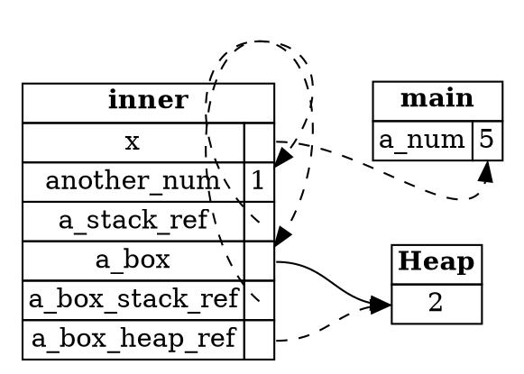

## The Runtime View

This step reviews how Rust uses memory while a program runs. If a concept is unclear, the links go back to the step
where it was covered.

---

### What lives where

* Rust allocates local variables in stack frames. A frame is created when a function is called, and removed when the
  call ends.
* A local variable can hold data, such as a number, a boolean, or a tuple, or a pointer.
* Pointers come in two kinds: boxes, which own data on the heap, and references, which don't own the data they point to.

The sample for this step has a function that creates all of these, and prints them:

```rust,ignore
fn inner(x: &mut i32) {
    let another_num = 1;
    let a_stack_ref = &another_num;

    let a_box = Box::new(2);
    let a_box_stack_ref = &a_box;
    let a_box_heap_ref = &*a_box;

    *x += 5;

    println!("{a_stack_ref} {a_box_heap_ref} {a_box_stack_ref}");
}
```

The output is:

```
1 2 2
a_num is now 5
```

`inner` prints first, because it runs before `main` continues. `a_num` is `5` by the time `main` prints it, because `inner`
changed it through the mutable reference `x`.

---

### Seeing the frames

The diagram shows the frames while `inner` is running. `main` holds `a_num`, which `inner` can change through `x`. The
frame for `inner` holds its own variables. Some point at the stack, and one points at the heap:



*Diagram adapted from the [Brown University edition of The Rust Programming Language](https://rust-book.cs.brown.edu/).*

Some questions to check your understanding:

* Why does `a_box_stack_ref` point at the stack, while `a_box_heap_ref` points at the heap? The first is a reference to
  the box variable, and the second is a reference to the value inside the box.
* Why is the value `2` no longer on the heap once `inner` returns? Its owner, `a_box`, went out of scope, and the box freed it.
* Why does `a_num` have the value `5` afterwards? The mutable reference `x` changed it.

If you want to review boxes, re-read [Chapter 4.1](ch04-01-what-is-ownership.html). If you want to review references,
re-read [Chapter 4.2](ch04-02-references-and-borrowing.html).

---

### Slices

A slice is a reference to a contiguous sequence of data. The slice `&s[2..5]` refers to three bytes in the middle of a
string, and stores a pointer to the first one and a length. If you want to review slices, re-read
[Chapter 4.4](ch04-04-slices.html).

---

### Try it in the runner

Press **F5**. The Output pane should show:

```
1 2 2
a_num is now 5
```

The comments in `src/main.rs` suggest printing `a_box_stack_ref` inside `inner`. It holds the same number as
`a_box_heap_ref`, but it has a different type, which the compiler knows even though the output looks the same.

---

*For more detail, see section 4.5 "Ownership Recap" in [The Rust Programming Language](https://doc.rust-lang.org/book/ch04-05-ownership-recap.html).*
