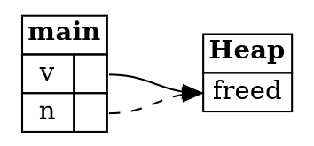

## Undefined behavior

Ownership, borrowing, and slices all have one purpose: preventing undefined behavior. This step connects the rules
to the two kinds of undefined behavior the chapter has been about.

---

### Use-after-free

A **use-after-free** reads or writes memory that has already been freed. The sample shows the safe way to avoid it. The
number is copied out of the vector before the vector changes:

```rust,ignore
let mut v = vec![1, 2, 3];
let n = v[0];
v.push(4);
println!("{n} {:?}", v);
```

The output is:

```
1 [1, 2, 3, 4]
```

If instead `n` held a reference into the vector, the `push` could reallocate the buffer and free the memory `n` points at.
The borrow checker prevents this by removing the write permission from `v` while `n` is in use. The diagram shows the
dangerous state the rule prevents:



*Diagram adapted from the [Brown University edition of The Rust Programming Language](https://rust-book.cs.brown.edu/).*

> **Why this is dangerous:** After a value is freed, the allocator may reuse its memory for something else. A program that
> reads through a stale pointer can see data it should never have access to, such as another user's details. A program that
> writes through one can change unrelated data, and attackers look for exactly that kind of control over a running program.
> This is one of the most commonly exploited kinds of memory bug.

---

### Double-free

A **double-free** frees the same memory twice. Dereferencing a reference to non-copyable data can cause one: it would give
two owners of the same heap data. The rule that prevents this is that references don't have the own permission.

> **Why this is dangerous:** Freeing memory twice corrupts the allocator's own bookkeeping. The allocator may then hand the
> same block to two different users, or write its bookkeeping into memory the program still controls. Attackers have used
> double-frees to take control of a program's behavior, which is why the rule above matters.

---

### What the borrow checker guarantees

The guarantee has two parts, and it's worth knowing both:

* The borrow checker always rejects programs with undefined behavior.
* The borrow checker sometimes rejects programs without undefined behavior, which are perfectly safe.

In technical terms, the borrow checker is *sound* (it never accepts an unsafe program) and *incomplete* (it sometimes rejects
a safe one). The step on fixing ownership errors showed how to handle the second case.

Two quiz questions show how to decide whether a rejected function is actually dangerous.

The first function, `extract`, takes a reference to a box and moves the value out of it, then dereferences a box that is
no longer owned. It would double-free on any input, so it *could* cause undefined behavior.

The second function, `transfer_string`, mutably borrows two fields of a tuple through two functions, and then changes both.
The borrow checker rejects it, because it can't tell that the two references always point to different fields. In this
program they never overlap, so it *could not* cause undefined behavior.

---

### Try it in the runner

Press **F5**. The Output pane should show:

```
1 [1, 2, 3, 4]
```

The comments in `src/main.rs` suggest keeping `n` as a reference, and printing it after the push. Rust rejects that for the
reason described above.

---

### Quiz

*These questions are adapted from the quizzes in the [Brown University edition of The Rust Programming Language](https://rust-book.cs.brown.edu/).*

````quiz
Select each of the following statements that is true about the kinds of programs accepted and rejected by the borrow checker.
These statements apply to programs that contain no `unsafe` code.

---
Does the borrow checker always reject programs that have undefined behavior?

○ False
→ Not quite. The borrow checker is designed so that it always rejects programs with undefined behavior.
◉ True
→ Yes. The borrow checker never accepts a program that could cause undefined behavior.
---
Does the borrow checker sometimes reject programs that do not have undefined behavior?

○ False
→ Not quite. The borrow checker is incomplete, so it sometimes rejects safe programs, such as the examples in the fixing ownership errors step.
◉ True
→ Yes. It can't always tell that a program is safe, so it rejects some safe programs.
````

````quiz
The function `extract` is rejected by the borrow checker:

```rust
fn extract(b: &Box<i32>) -> i32 {
    let b2: Box<i32> = *b;
    *b2
}
```

Imagine that the borrow checker did not reject this function. Could there be an input for which the function causes undefined behavior?

○ This function could NOT cause undefined behavior
→ Not quite. Moving the box out of a reference would give two owners of the same heap data, so it does cause a double-free.
◉ This function COULD cause undefined behavior
→ Yes. It moves a box out of a reference, which would be freed twice, once for each owner.
````

````quiz
The function `transfer_string` is rejected by the borrow checker:

```rust
fn get_first(strs: &mut (String, String)) -> &mut String {
    &mut strs.0
}

fn get_second(strs: &mut (String, String)) -> &mut String {
    &mut strs.1
}

fn transfer_string(strs: &mut (String, String)) {
    let fst = get_first(strs);
    let snd = get_second(strs);
    fst.push_str(snd);
    snd.clear();
}
```

Imagine that the borrow checker did not reject this function. Could there be an input for which the function causes undefined behavior?

◉ This function could NOT cause undefined behavior
→ Yes. The borrow checker rejects it because it can't see that `get_first` and `get_second` return references to different fields. They always do, so the function is safe.
○ This function COULD cause undefined behavior
→ Not quite. `fst` and `snd` always point to different strings, so no input makes them overlap.
````

---

*For more detail, see section 4.5 "Ownership Recap" in [The Rust Programming Language](https://doc.rust-lang.org/book/ch04-05-ownership-recap.html).*
