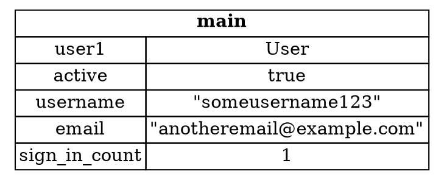

## Defining and Instantiating Structs

A struct groups several related values under one name. Tuples do something similar, but in a struct each piece of data has a
name, so its meaning is clear. You don't have to remember the order of the values to find the one you want.

Each name describes what the values mean together. A `User` struct, for example, groups the facts about one account.

---

### Defining a struct

A struct is defined with the `struct` keyword, a name, and curly brackets containing the *fields*: each field has a name and a type.

```rust,ignore
struct User {
    active: bool,
    username: String,
    email: String,
    sign_in_count: u64,
}
```

The fields can have different types. Here the account is active or not, has a name and an email, and counts how many times it has signed in.

The definition is a template. It doesn't hold any data itself, and it's only used when you create an *instance* of the struct.

---

### Creating an instance

To create an instance, write the struct's name, then curly brackets containing `field: value` pairs. The fields can be given in any order, as long as each one appears once.

The sample for this step creates a `User` and uses it. Here's the program:

```rust,ignore
fn main() {
    let mut user1 = User {
        email: String::from("someone@example.com"),
        username: String::from("someusername123"),
        active: true,
        sign_in_count: 1,
    };

    println!(
        "{} signed in {} time(s), active: {}",
        user1.username, user1.sign_in_count, user1.active
    );

    user1.email = String::from("anotheremail@example.com");
    println!("new email: {}", user1.email);
}
```

Its output is:

```
someusername123 signed in 1 time(s), active: true
new email: anotheremail@example.com
```

---

### Getting and changing values

To read a field, use dot notation: `user1.email` is the email address. To change a field, assign to it with dot notation,
as the program does with `user1.email = ...`.

The whole instance must be mutable for this to work. Rust doesn't let you mark only some fields as mutable. If the `mut` is
left off `user1`, Rust rejects the assignment, because the instance has no write permission.

The diagram shows the instance and its fields as they stand after the change:



*Diagram adapted from the [Brown University edition of The Rust Programming Language](https://rust-book.cs.brown.edu/).*

---

### Try it in the runner

Press **F5**. The Output pane should show:

```
someusername123 signed in 1 time(s), active: true
new email: anotheremail@example.com
```

The comments in `src/main.rs` suggest removing `mut` from `user1`. Rust rejects the assignment to `user1.email`, and the error
says the instance is not mutable.

---

*For more detail, see section 5.1 "Defining and Instantiating Structs" in [The Rust Programming Language](https://doc.rust-lang.org/book/ch05-01-defining-structs.html).*
