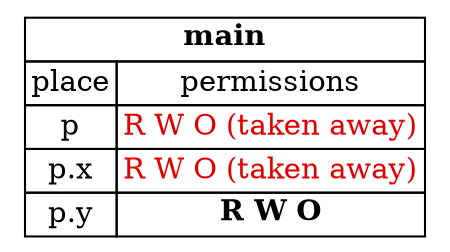

## Borrowing Fields of a Struct

In Chapter 4, you saw that Rust tracks permissions on tuple fields separately. Structs work the same way. Borrowing one field
of a struct doesn't necessarily stop you using the others, and the borrow checker can see the difference.

---

### Two fields at once

The sample borrows both fields of a `Point` mutably, at the same time:

```rust,ignore
let mut p = Point { x: 1, y: 2 };

let x = &mut p.x;
let y = &mut p.y;
*x += 1;
*y += 1;

println!("{} {}", p.x, p.y);
```

Its output is:

```
2 3
```

This compiles, because `p.x` and `p.y` are different places. The borrow of `p.x` doesn't affect `p.y`, so both borrows can
be live together.

---

### What a field borrow takes away

A borrow of a field removes permissions from that field, and from the struct it belongs to. The diagram shows the state after
`let x = &mut p.x;`, while `x` is still in use. Active permissions are in bold. Permissions that have been taken away are shown in
red, with the note in the text:



*Diagram adapted from the [Brown University edition of The Rust Programming Language](https://rust-book.cs.brown.edu/).*

The struct `p` loses its permissions, because it contains `p.x`. The field `p.y` keeps all of its permissions. That's why the second
borrow, `&mut p.y`, is allowed.

---

### When the whole struct is needed

If you try to use the whole struct while one field is borrowed, Rust rejects it. The sample from the book passes `&p` to a function
while `p.x` is still borrowed mutably:

```rust,ignore
fn print_point(p: &Point) {
    println!("{}, {}", p.x, p.y);
}

fn main() {
    let mut p = Point { x: 0, y: 0 };
    let x = &mut p.x;
    print_point(&p);
    *x += 1;
}
```

Rust reports:

```text
error[E0502]: cannot borrow `p` as immutable because it is also borrowed as mutable
```

The line numbers depend on your version. The message says that `p` is borrowed as a whole, which conflicts with the field borrow
still in use. The function only reads the point, but the compiler can't know which fields it will read, so it assumes the whole
struct is needed.

Rust can sometimes be more cautious than necessary, so it may reject a safe program. When it does, look at which fields the code really
needs, and borrow only those.

---

### Try it in the runner

Press **F5**. The Output pane should show:

```
2 3
```

The comments in `src/main.rs` suggest calling a function with `&p` between the two borrows. Rust rejects that for the reason above.

---

### Quiz

*These questions are adapted from the quizzes in the [Brown University edition of The Rust Programming Language](https://rust-book.cs.brown.edu/).*

````quiz
Does this program compile?

```rust
struct Point {
  x: i32,
  y: i32,
}

fn main() {
  let mut p = Point { x: 1, y: 2 };
  let x = &mut p.x;
  let y = &mut p.y;
  *x += 1;
  *y += 1;
  println!("{} {}", p.x, p.y);
}
```

○ This program does not compile
→ Not quite. Rust tracks `p.x` and `p.y` separately, so borrowing them at the same time is allowed.
◉ This program does compile
→ Yes. The two borrows are of different fields, so they don't conflict.
---
If it compiles, what does it print?

[ 2 3 ]
→ Yes. Each field is increased by one, so `p.x` is 2 and `p.y` is 3.
````

---

*For more detail, see section 5.1 "Defining and Instantiating Structs" in [The Rust Programming Language](https://doc.rust-lang.org/book/ch05-01-defining-structs.html).*
